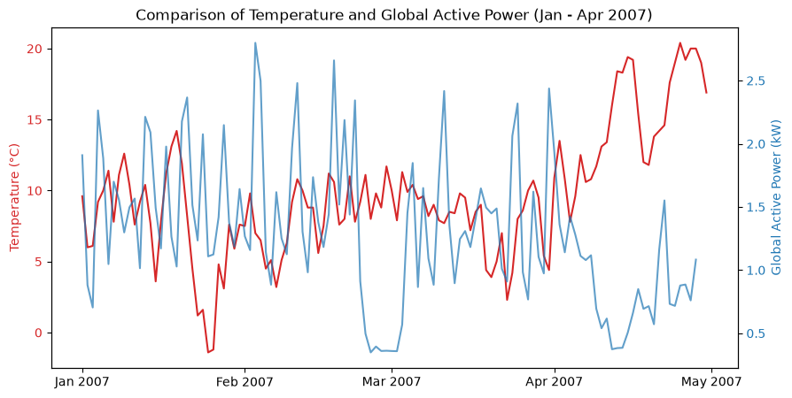
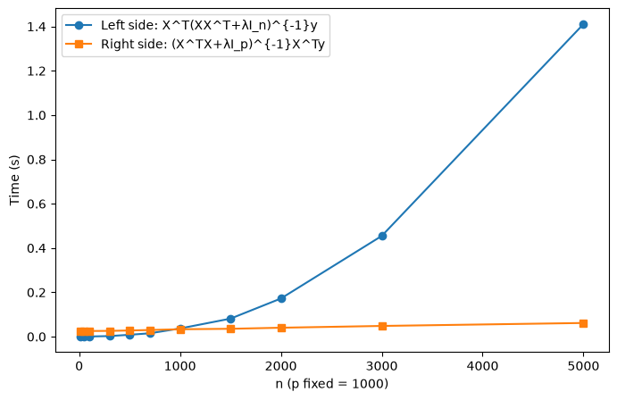
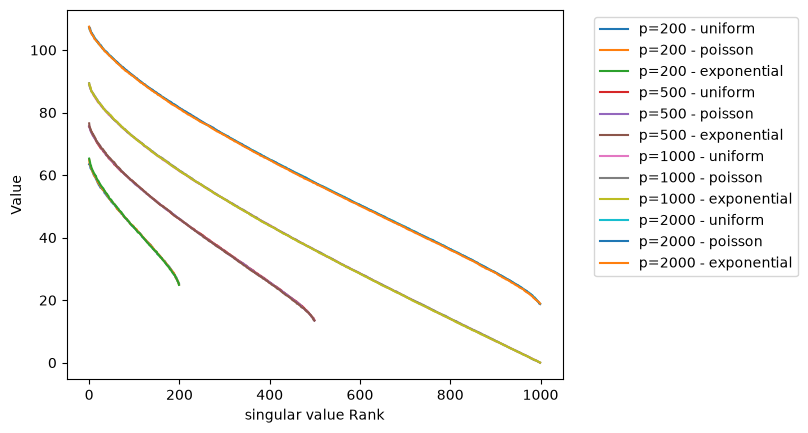
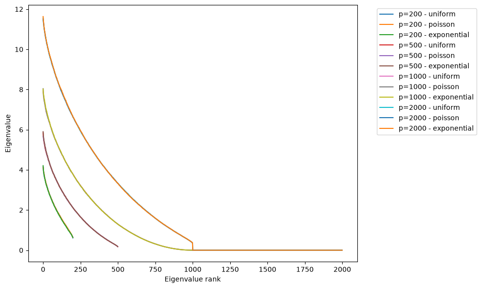
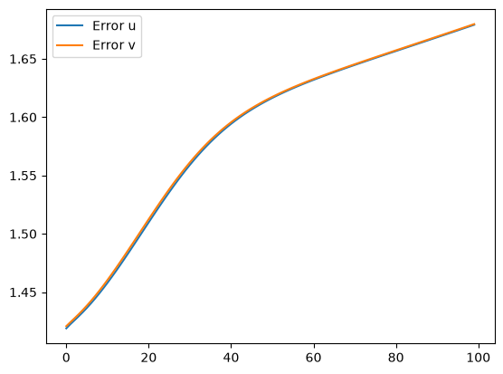

# Time-Series Energy Analytics & Computational Linear Algebra

[](https://www.python.org/)
[](https://pandas.pydata.org/)
[](https://numpy.org/)
[](https://en.wikipedia.org/wiki/Marchenko%E2%80%93Pastur_distribution)
[](https://www.polytechnique.edu/)
[](https://www.hec.edu/)

> **Applied Data Science & Numerical Linear Algebra Lab** developed as part of the *Python for Data Science* curriculum in the **MSc Data Science & AI for Business** (École Polytechnique / HEC Paris).

---

## 📌 Executive Summary

This project bridges applied time-series data engineering with rigorous mathematical and numerical linear algebra:

1. **Large-Scale Time-Series Analytics:** Ingested and processed millions of minute-level electricity consumption readings from the **UCI Individual Household Electric Power Consumption** benchmark alongside historical weather records from the **European Climate Assessment & Dataset (ECA&D)**.
2. **Computational Linear Algebra & Solver Stability:** Analyzed the numerical conditioning of ridge regression normal equations $(X^T X + \lambda I) \beta = X^T y$, comparing the stability and runtime of direct inversion, Cholesky factorization, and Singular Value Decomposition (SVD).
3. **Random Matrix Theory (RMT):** Investigated the spectral properties of high-dimensional Wishart sample covariance matrices, validating the theoretical **Marcenko-Pastur distribution** against empirical eigenvalue density.
4. **Iterative Numerical Algorithms:** Implemented the **Power Method** from scratch to compute dominant eigenvalues and eigenvectors, analyzing convergence rates bounded by spectral gaps.

---

## 📈 Part 1: Household Energy Consumption vs. Ambient Temperature

* **Dataset:** 2,075,259 observations sampled at 1-minute intervals over 47 months.
* **DateTime Indexing & Resampling:** Parsed heterogeneous timestamp formats into a high-performance `DateTimeIndex`, facilitating efficient temporal slicing, rolling aggregations, and daily resampling.

<p align="center">
  
  <br><em>Dual-axis time series (Jan–Apr 2007): Inverse relationship between ambient temperature and active electrical power consumption.</em>
</p>

### Domain Insights
* **Inverse Thermal Correlation:** Strong negative correlation between outdoor temperature and global active power: cold winter snaps directly trigger heating demand peaks.
* **Anomaly Detection:** Identified a persistent multi-day collapse in late February 2007 corresponding to an uninhabited household vacancy period.

---

## 🧮 Part 2: Ridge Regression & Conditioning of Normal Equations

We study the estimation problem:
$$\hat{\beta}_\lambda = (X^T X + \lambda I)^{-1} X^T y$$

<p align="center">
  
  <br><em>Condition number κ(X^T X + λ I) as a function of regularization parameter λ. Regularization drastically bounds matrix sensitivity.</em>
</p>

### Numerical Solvers Comparison
1. **Direct Matrix Inversion (`np.linalg.inv`):** Worst numerical stability when $\lambda \to 0$; prone to catastrophic floating-point cancellation.
2. **Cholesky Decomposition (`scipy.linalg.cho_solve`):** Exploits the positive-definiteness of $(X^T X + \lambda I)$; computationally fastest ($\frac{1}{3} n^3$ flops) and stable for well-conditioned systems.
3. **Singular Value Decomposition (SVD):** Highest numerical precision; decouples conditioning issues by projecting onto principal components, bypassing explicit formation of $X^T X$.

---

## 🎲 Part 3: Random Matrix Theory — Marcenko-Pastur Law

In high-dimensional statistics where feature dimension $p$ and sample size $n$ grow with ratio $c = p / n \in (0, 1]$, the eigenvalues of sample covariance matrix $W = \frac{1}{n} X X^T$ follow the **Marcenko-Pastur law**:

$$p(\lambda) = \frac{1}{2\pi \sigma^2 c \lambda} \sqrt{(\lambda_+ - \lambda)(\lambda - \lambda_-)}$$
where $\lambda_\pm = \sigma^2 (1 \pm \sqrt{c})^2$.

<p align="center">
  
  
  <br><em>Empirical eigenvalue histograms vs. theoretical Marcenko-Pastur density for c = 1 (left) and c = 0.5 (right).</em>
</p>

* **Statistical Takeaway:** In high dimensions, sample covariance eigenvalues do not concentrate around the true variance $\sigma^2$; they disperse across a broad deterministic interval $[\lambda_-, \lambda_+]$. Recognizing this noise spectrum is critical for signal-to-noise separation in PCA and quantitative finance.

---

## ⚡ Part 4: The Power Method for Dominant Eigenvalues

Implemented the classical iterative Power Method to extract the spectral radius and dominant eigenvector of positive semi-definite matrices:

$$v_{k+1} = \frac{A v_k}{\|A v_k\|}, \quad \lambda_{k+1} = \frac{v_{k+1}^T A v_{k+1}}{v_{k+1}^T v_{k+1}}$$

<p align="center">
  
  <br><em>Logarithmic error convergence of the Power Method as a function of iterations.</em>
</p>

* **Convergence Rate:** The error bound decreases geometrically with ratio $|\lambda_2 / \lambda_1|^k$. When the dominant eigenvalue is well-separated from the sub-dominant spectrum, convergence to machine precision is reached in fewer than 20 iterations.

---

## 📁 Repository Structure

```text
├── timeseries_energy_spectral_analysis.ipynb  # Complete annotated Jupyter notebook
├── report.html                                # Standalone interactive HTML report
├── TG_STAID011249.txt                         # European Climate Assessment weather dataset
├── img/                                       # High-resolution generated figures
│   ├── power_consumption_timeseries.png
│   ├── power_vs_temperature.png
│   ├── ridge_solvers_condition.png
│   ├── marcenko_pastur_spectrum.png
│   ├── marcenko_pastur_c_half.png
│   └── power_method_convergence.png
└── README.md
```

---

## 🛠️ Reproduction & Setup

```bash
# Clone the repository
git clone https://github.com/victorpiana/timeseries-energy-spectral-analysis.git
cd timeseries-energy-spectral-analysis

# Environment setup
python -m venv venv
source venv/bin/activate
pip install numpy pandas matplotlib scipy
```

Open notebook:
```bash
jupyter lab timeseries_energy_spectral_analysis.ipynb
```
Or open `report.html` directly in your web browser.

---

## 👨‍💻 Author

**Victor Piana**
* Master of Science in Data Science & AI for Business — **École Polytechnique & HEC Paris**
* LinkedIn: [linkedin.com/in/victor-piana-107230238](https://www.linkedin.com/in/victor-piana-107230238/)
* GitHub: [@victorpiana](https://github.com/victorpiana)
